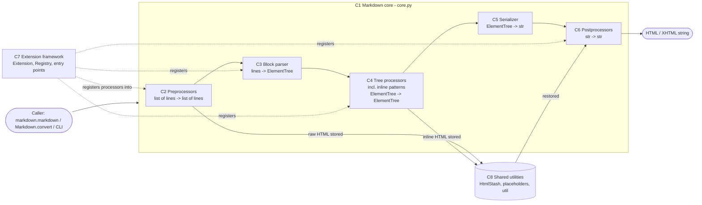

# Architecture of Python-Markdown (target repository)

| | |
|---|---|
| Repository | [Python-Markdown/markdown](https://github.com/Python-Markdown/markdown), forked as [MittalManas2005/markdown](https://github.com/MittalManas2005/markdown) |
| Pinned commit | `3f2c5510bd8d64a73ec18342f740371bcde9b20c` (`git describe`: `3.11.2-10-g3f2c551`, 2026-10-27) |
| Scope | The Python-Markdown library **as it exists at the pinned commit**. This document does not describe the AutoSE workflow; see `architecture/` for that. |
| Evidence | Every factual claim cites `path:line` at the pinned commit. Claims marked *(run)* were also checked by executing code at the pinned commit. Section 5 lists how each claim was verified. |
| Location | Kept in the AutoSE submission repository ([MittalManas2005/autose-a3](https://github.com/MittalManas2005/autose-a3)), **not** in the fork. The AutoSE workflow passes it to the Design agent as context; the mechanism is documented in the AutoSE ADRs under `architecture/decisions/`. Paths cited here (e.g. `markdown/core.py`) are paths inside the target repository. |

> **For automated agents:** treat this document as a map, not as ground truth. If anything here disagrees with the source code at the commit you are working on, the source code wins. Record the discrepancy in your output.

---

## 1. Purpose in one paragraph

Python-Markdown converts Markdown text into HTML or XHTML. Callers use `markdown.markdown(text, **kwargs)` or the `markdown.Markdown` class (`markdown/__init__.py:42-48`, `markdown/core.py:46`, `markdown/core.py:484`). The converter is a fixed five-step pipeline (`markdown/core.py:332-343`). Almost all behaviour lives in small *processors* that are plugged into that pipeline through priority-ordered registries. The built-in Markdown syntax and the 18 bundled extensions (`pyproject.toml:73-91`) use the same plug-in mechanism that third-party extensions use.

## 2. Component overview

### 2.1 Diagram

Data handed between stages, verified in `Markdown.convert` (`markdown/core.py:322-399`):
1. `str`, split on `"\n"`;
2. `list[str]` after the preprocessors;
3. an `ElementTree` root `Element` after `BlockParser.parseDocument`;
4. an `Element`, transformed in place or replaced, after the tree processors;
5. a `str` after the serializer;
6. a `str` after the postprocessors.

### 2.2 Components

| # | Component | Main files | Responsibility | Interactions |
|---|---|---|---|---|
| C1 | **Markdown core / public API** | `markdown/core.py`, `markdown/__init__.py`, `markdown/__main__.py` (CLI) | Holds configuration and per-document state, builds the registries (`core.py:133-158`), loads extensions (`core.py:161-248`), and runs the pipeline (`core.py:322-399`). The public API is `Markdown`, `markdown`, `markdownFromFile` (`__init__.py:48`). | Owns one instance of each other component. Every processor receives the `Markdown` instance (`md`). |
| C2 | **Preprocessors** | `markdown/preprocessors.py`, `markdown/htmlparser.py` | Line-level rewriting before parsing. Built in: `normalize_whitespace` (30) and `html_block` (20) (`preprocessors.py:40-41`). `HtmlBlockPreprocessor` uses `HTMLExtractor` to cut raw HTML blocks out into the stash (`preprocessors.py:82-88`). Interface: `run(lines: list[str]) -> list[str]` (`preprocessors.py:56`). | Writes to C8 (stash). Extensions add more, e.g. `fenced_code_block` at 25 (`extensions/fenced_code.py:58`). |
| C3 | **Block parser and block processors** | `markdown/blockparser.py`, `markdown/blockprocessors.py` | Splits the text into blank-line-separated blocks and lets the first matching block processor build `Element`s (`blockparser.py:100-160`). Each processor implements `test(parent, block)` and `run(parent, blocks)` (`blockprocessors.py:108,126`). Built in, highest priority first: `empty` 100, `indent` 90, `code` 80, `hashheader` 70, `setextheader` 60, `hr` 50, `olist` 40, `ulist` 30, `quote` 20, `reference` 15, `paragraph` 10 (`blockprocessors.py:45-55`). Nested parsing is recursive, with a guard against Python's recursion limit (`util.py:177`, used at `blockprocessors.py:290`). | Produces the tree consumed by C4. |
| C4 | **Tree processors and inline patterns** | `markdown/treeprocessors.py`, `markdown/inlinepatterns.py` | Transform the tree. Built in: `inline` 20, `prettify` 10, `unescape` 0 (`treeprocessors.py:42-44`). `InlineProcessor` runs the inline-pattern registry (`backtick` 190 … `em_strong` 60, `inlinepatterns.py:74-93`) over element text, using placeholder strings to protect already-processed fragments (`treeprocessors.py:81-93`, `util.py:71-75`). Text marked `AtomicString` is not processed further (`util.py:186-188`). Interface: `run(root) -> Element | None` (`treeprocessors.py:65`). | Reads and writes the tree. Stores inline raw HTML in C8. Extensions add tree processors, e.g. `hilite` 30 (`extensions/codehilite.py:350`), `attr_list` 8 (`extensions/attr_list.py:239`), `smarty` 6 (`extensions/smarty.py:290`), `toc` 5 (`extensions/toc.py:511`). |
| C5 | **Serializer** | `markdown/serializers.py` | Renders the tree to HTML or XHTML; the format is chosen through `Markdown.output_formats` (`core.py:79`, `core.py:286-305`). Attribute values must be `str`, or `None` for a valueless attribute, which is written as a bare name (`serializers.py:186-196`). Any other type raises `TypeError("cannot serialize …")` (`serializers.py:80-83`). | Called once by C1 between C4 and C6. |
| C6 | **Postprocessors** | `markdown/postprocessors.py` | Text-level fixes after serialization. Built in: `raw_html` 30, which puts stashed HTML back in place of the placeholders (`postprocessors.py:42`, `postprocessors.py:73-93`), and `amp_substitute` 20 (`postprocessors.py:43`). Interface: `run(text: str) -> str` (`postprocessors.py:58`). | Reads C8. |
| C7 | **Extension framework and bundled extensions** | `markdown/extensions/__init__.py`, `markdown/extensions/*.py`, `markdown/util.py` (`Registry`), `pyproject.toml` | `Extension` base class with a `config` dict of `[default, description]` pairs and `extendMarkdown(md)` (`extensions/__init__.py:37-113`). Extensions are resolved by entry-point name, then by dotted import path (`core.py:197-248`, `pyproject.toml:73-91`). All stages are `util.Registry` objects ordered by numeric priority (`util.py:270-409`). | Registers processors into C2, C3, C4 and C6; may keep per-document state, reset via `registerExtension` (`core.py:250-263`). |
| C8 | **Shared utilities** | `markdown/util.py`, `markdown/test_tools.py` | `HtmlStash` stores raw HTML and returns placeholders (`util.py:213-250`). The placeholder formats use the control characters STX/ETX (`util.py:67-81`). Also `parseBoolValue` (`util.py:136`), the `deprecated` decorator (`util.py:111`), and `test_tools.TestCase.assertMarkdownRenders` for tests (`test_tools.py:39-61`). | Used by every other component. |

### 2.3 How an extension plugs in (worked example, verified)
The `toc` extension registers a tree processor at priority 5 (`extensions/toc.py:511`), so it runs after:
- `inline` (20),
- `prettify` (10),
- `attr_list` (8) and `smarty` (6), when those are enabled,

and before `unescape` (0). Because it runs before `unescape`, `toc` unescapes the attribute values it reads itself (`extensions/toc.py:408`, `extensions/toc.py:417`). Cross-extension ordering of this kind is tuned by changing priorities. For example, the changelog records "Give smarty tree processor higher priority than toc (#1440)" (`docs/changelog.md:241`).

---

## 3. Architectural decisions (Nygard format)

These ADRs are reconstructed from the project's own documentation and code. The upstream project did not write them as ADRs. Each cites the source of its context.

### ADR-T1: Use ElementTree as the intermediate document model
- **Status:** Accepted (since version 2.0; `docs/change_log/release-2.0.md:30-31`).
- **Context:** Before 2.0 the converter built output with "the old home-grown NanoDOM". The 2.0 release notes say moving to ElementTree "resolved various issues with the older home-grown NanoDOM and made notable increases in performance" (`docs/change_log/release-2.0.md:41-44`). Extensions need a structured, mutable representation of the document between parsing and output.
- **Decision:** Block processors build a tree of `xml.etree.ElementTree` elements (`blockparser.py:100-118`). Tree processors transform it (`core.py:370-375`). A serializer renders it (`core.py:379`, `serializers.py:140`).
- **Alternatives considered:**
  - (a) the home-grown DOM (NanoDOM), which was used before 2.0 and replaced;
  - (b) building output strings directly with regular-expression substitutions and no tree;
  - (c) a custom token stream / abstract syntax tree owned by the project.
- **Consequences:**
  - Positive: extensions get a standard, documented tree API (`docs/extensions/api.md:208-216`), and tree-level features (tables of contents, footnotes, attribute lists) can inspect and rewrite structure.
  - Negative: ElementTree is an XML data model. Attribute values must be strings (or `None` for valueless attributes), or serialization fails (`serializers.py:80-83`, `serializers.py:186-196`). Arbitrary raw HTML cannot live in the tree, which leads to ADR-T3. ElementTree's `text`/`tail` model forces inline processing to work through placeholders (`treeprocessors.py:81-93`).

### ADR-T2: Order every processing stage with a priority-sorted registry
- **Status:** Accepted (since 3.0.0; `docs/changelog.md:752`, `docs/changelog.md:880-885`). It supersedes the OrderedDict approach of 2.0 (`docs/change_log/release-2.0.md:32-34`).
- **Context:** Many independently written extensions must insert processors at specific points in each stage, and some must replace built-ins. In 2.x, stages were OrderedDicts. The 3.0.0 changelog records that the "Homegrown `OrderedDict` has been replaced with a purpose-built `Registry`" with a backwards-compatible shim (`docs/changelog.md:880-885`).
- **Decision:** Each stage is a `util.Registry`. Items are registered with a unique name and a numeric priority and are kept sorted from highest to lowest priority (`util.py:270-312`, `util.py:362-386`, `util.py:403-409`). Registering an existing name replaces the old item (`util.py:368-381`).
- **Alternatives considered:**
  - (a) plain lists in a fixed order (pre-2.0);
  - (b) OrderedDicts with relative positions (2.x);
  - (c) explicit before/after dependency declarations between processors.
- **Consequences:**
  - Positive: extensions can insert, replace or remove (`deregister`, `util.py:388-398`) any processor by name without editing core code.
  - Negative: the order is a global, implicit contract. Correctness can depend on relative priorities chosen by different authors (e.g. `docs/changelog.md:241`). Changing a built-in name or priority can silently break third-party extensions. Replacement by name loses the old item without warning (`util.py:371-375`).

### ADR-T3: Pass raw HTML through a stash with placeholders instead of parsing it
- **Status:** Accepted (current; documented in `docs/extensions/api.md:506-512`).
- **Context:** Markdown allows raw HTML in the input. ElementTree cannot represent arbitrary or malformed HTML faithfully (ADR-T1). Extensions such as code highlighters also produce ready-made HTML strings that must not be re-escaped (`docs/extensions/api.md:506-508`).
- **Decision:**
  - Raw HTML is removed from the text or tree and stored in `md.htmlStash` (`util.py:213-250`).
  - A placeholder delimited by STX/ETX control characters is inserted in its place (`util.py:67-81`).
  - After serialization, `RawHtmlPostprocessor` substitutes the stored HTML back (`postprocessors.py:73-93`).
  - Block-level raw HTML is extracted by `HtmlBlockPreprocessor`, using `HTMLExtractor` (`preprocessors.py:82-88`).
- **Alternatives considered:**
  - (a) parse raw HTML into ElementTree nodes;
  - (b) escape all raw HTML so it shows as text;
  - (c) leave raw HTML in the text and keep it from being re-processed by convention only.
- **Consequences:**
  - Positive: raw HTML and pre-rendered fragments reach the output unchanged.
  - Negative: every processor must leave placeholder text intact, since the placeholders are just strings in the tree. Markdown inside raw HTML is not processed unless a dedicated extension (`md_in_html`) is used. Restoring the HTML is a string substitution after serialization, so stashed content cannot be inspected as a tree.

### ADR-T4: Do not sanitize output; leave security filtering to the caller
- **Status:** Accepted (since 3.0, when `safe_mode` was deprecated; `docs/changelog.md:782-791`).
- **Context:** Earlier versions offered a `safe_mode`. The 3.0 changelog says it "was never actually 'safe' which has resulted in many people having a false sense of security when using it" and recommends passing untrusted output "through an HTML sanitizer … after being converted to HTML by markdown" (`docs/changelog.md:782-791`).
- **Decision:** The library emits HTML without sanitizing it and documents this prominently (`docs/sanitization.md`; warnings in `core.py:345-346`, `core.py:426-427`, `core.py:501`).
- **Alternatives considered:**
  - (a) keep and harden a built-in safe mode;
  - (b) always escape raw HTML;
  - (c) bundle a sanitizer as a dependency.
- **Consequences:**
  - Positive: the converter has no mandatory runtime dependencies (`pyproject.toml:47` defines only optional dependency groups), and it makes no security promise it cannot keep.
  - Negative: callers who process untrusted input must add a sanitizer themselves. Any change that alters how attributes, URLs or raw HTML are emitted can affect downstream security without the library noticing.

---

## 4. Architectural constraints (preserve these in any change)

| # | Constraint | Why it matters | Evidence |
|---|---|---|---|
| K1 | **Stage interfaces are a public contract.** Preprocessors map `list[str] → list[str]`. Block processors implement `test(parent, block)` / `run(parent, blocks)` against the tree. Tree processors implement `run(root)` and return `None` or a replacement root. Postprocessors map `str → str`. | Third-party extensions implement these interfaces. Changing a signature or a return convention breaks them. | `preprocessors.py:56`, `blockprocessors.py:108,126`, `treeprocessors.py:65`, `postprocessors.py:58`, `core.py:365-399`, `docs/extensions/api.md:211-216` |
| K2 | **New behaviour is added through registries with a name and priority, not by editing the pipeline.** Existing processor names and priorities must not change without a documented reason. A new processor's priority must be chosen against the processors it interacts with. | Order is a global implicit contract (ADR-T2). For example, `toc` (5) relies on running after `attr_list` (8) and before `unescape` (0). | `util.py:270-409`, `blockprocessors.py:45-55`, `treeprocessors.py:42-44`, `inlinepatterns.py:74-93`, `extensions/toc.py:511`, `extensions/attr_list.py:239`, `docs/changelog.md:241` |
| K3 | **Element attribute values must be `str`, or `None` for a valueless attribute.** Code that reads attributes must handle `None`, because `attr_list` stores valueless attributes as `None`. Code that writes attributes or HTML attribute strings must not pass other types (`bool`, `int`). | The serializer renders `None` as a bare attribute and raises `TypeError` for any other non-string value. | `serializers.py:80-83`, `serializers.py:123-138`, `serializers.py:186-196`, `extensions/attr_list.py:59-63`, `extensions/attr_list.py:75-78` |
| K4 | **Raw HTML and pre-rendered fragments go through `md.htmlStash`. Placeholder text must never be altered.** | Placeholders (STX/ETX-delimited) are replaced after serialization. Altering or splitting one loses or corrupts output. | `util.py:67-81`, `util.py:213-250`, `postprocessors.py:73-93`, `docs/extensions/api.md:506-512` |
| K5 | **Backward compatibility of the public surface.** Keep `Markdown`, `markdown`, `markdownFromFile`, the extension entry-point names and existing config option names. Removals go through deprecation (`util.deprecated`) and a changelog entry. Supported Python: `>=3.11`. No new mandatory runtime dependency. | Downstream users and extensions rely on these names. The project deprecates before it removes. | `__init__.py:42-48`, `pyproject.toml:22`, `pyproject.toml:47`, `pyproject.toml:73-91`, `util.py:111`, `docs/changelog.md:782-786` |

### 4.1 Development conventions (checked by CI or required by the contributing guide)
- **Tests.** Every new feature needs tests, and every changed feature needs updated tests (`docs/contributing.md:93-96`). Syntax tests use `markdown.test_tools.TestCase.assertMarkdownRenders(source, expected, **kwargs)` (`test_tools.py:39-61`) under `tests/test_syntax/`.
  - The suite runs with `python -m unittest discover tests` (`tox.ini`), and at the pinned commit it is 1,166 tests with 13 skipped *(run)*.
  - Running `pytest tests` fails during collection: `tests/test_legacy.py:27` turns warnings into errors at import time *(run)*. Use `unittest`, or have pytest collect that file last.
- **Changelog.** Any change to code under `markdown/` needs an entry under `[Unreleased]` in `docs/changelog.md` (`docs/contributing.md:535-547`). CI enforces this for pull requests touching `markdown/**` (`.github/workflows/changelog-enforcer.yml`).
- **Style.** flake8 with `max-line-length = 119` (`tox.ini:45-46`). Documentation is spell-checked (`.pyspelling.yml`), and the built changelog is part of the docs site.

---

## 5. Verification record

All claims were checked against commit `3f2c551` on 2026-11-22.

| Section | Claim | How verified |
|---|---|---|
| 1, 2.1 | Five-step pipeline and the data types between stages | Read `core.py:322-399` |
| 2.2 C2–C6 | Built-in processor names and priorities | Read every `.register(` call in `preprocessors.py`, `blockprocessors.py`, `treeprocessors.py`, `inlinepatterns.py`, `postprocessors.py` |
| 2.2 C7, 2.3 | Extension priorities (`fenced_code` 25, `codehilite` 30, `attr_list` 8, `smarty` 6, `toc` 5) | Read the `.register(` calls in each extension file |
| 2.2 C5, K3 | `None` renders as a bare attribute; other non-strings raise `TypeError` | Read `serializers.py:80-83,186-196`; ran `markdown.markdown("# H {: id }", extensions=["attr_list"])` → `<h1 id>H</h1>` *(run)* |
| 2.2 C3 | Recursion guard | Read `util.py:177`, `blockprocessors.py:290` |
| ADR-T1 | NanoDOM → ElementTree in 2.0, and the stated reasons | Read `docs/change_log/release-2.0.md:27-48` |
| ADR-T2 | OrderedDict → Registry in 3.0.0 | Read `docs/changelog.md:752,880-885` |
| ADR-T3 | Stash mechanism | Read `util.py:213-250`, `postprocessors.py:73-93`, `docs/extensions/api.md:506-512` |
| ADR-T4 | `safe_mode` deprecation and the no-sanitization policy | Read `docs/changelog.md:782-791`, `docs/sanitization.md`, `core.py:345-346` |
| K5 | Public API, Python version, no runtime dependencies | Read `__init__.py:42-48`, `pyproject.toml:22,47,73-91` |
| 4.1 | Test count, `unittest` vs `pytest` behaviour | Ran both at the pinned commit *(run)* |

**Corrections made while drafting.**
- An early assumption that the suite runs under pytest was wrong; see 4.1.
- No other discrepancies between the project's documentation and its code were found for the claims above.
